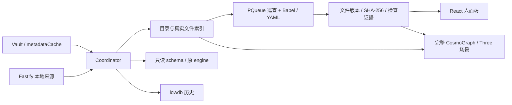

# 原生插件架构与开发入口

这是一个 Obsidian 桌面插件。浏览器测试入口复用生产 Dashboard、WorldScene、Patrol 与解析器；它的合成数据不替代宿主测试。

`src/main.ts` 继承完整 CosmoGraph 原生注册类，`ObservatoryView` 继承原 ItemView。视图使用 Shadow DOM、React 和官方 shadcn/ui，避免 Tailwind 和 Radix 弹层影响笔记或其他插件。每个 vault 共享一个随插件启用运行的 Coordinator，多视图各有独立 WebGL、物理 Worker 和弹层；关闭视图释放对应图形资源，观察器、巡查、历史与接收端口继续运行，插件卸载时统一释放。

WorldScene 直接继承 CosmoGraph.SphericalGraph，保留上游场景、后处理、背景、文件球材质、标签和拾取。世界对应真实一级目录，一个独立 Three Group 包含文件小球、目录辅助线和轨道。没有实际文件时不添加假文件。默认布局直接解析原 SVG 的世界位置、轮廓、点径与分支模板，并用三维深度投影为真实文件球，配置按稳定世界 ID 保存；新增世界不重排已保存世界。

小球使用共享 SphereGeometry、有光照的材质与 InstancedMesh；真实球面与径向层次对应文件数，中心优先绑定实际索引。独立 Worker 内的 d3-force-3d 统一计算内部及跨球关系，结合世界中心、径向层次、碰撞和边界约束。位置帧包含图版本和指令序号，过期帧不覆盖新拖动。OrbitControls 操作镜头，TransformControls 提供 XYZ 平移与旋转，DragControls 通过同步拾取代理分别拖动文件与世界。世界拖动保留成员局部坐标；渲染、拾取、真实边和蜘蛛使用同一坐标。LineSegments2 提供可调像素线宽，辅助线不进入关系统计。

Patrol 每个可配置间隔至多调度一个任务，变化文件优先，余下文件轮转。同版本遵守复查间隔。PQueue 限制串行读取；结果同时验证任务 epoch 和当前文件版本。内容变化后旧结果丢弃并重新排队。暂停和回放会使在途结果失效。Cyto­scape 只使用真实关系寻找路径；找不到路径时明确直接定位。蜘蛛复用 Quaternius 的真实模型和骨骼动画，其任务来自检查证据。

原 v3 engine 与 project-index 通过只读 facade 调用 inspect / collect。插件核验 vault 引擎字节哈希，不执行变更引擎。schema 可兼容更新。检查范围由原引擎决定，未知世界或非业务文件显示未评估。文件级语法结果与最近业务检查时间分别保存。

所有可调参数登记在 `src/core/settings.ts`，自动生成可视化控件和校验；独立世界与面板布局另有 Ajv 契约。布局导入不执行代码，导出无凭据。源文件、模板和 Prompt 都是观察数据。

历史与持久状态通过 lowdb 的原子 JSONFile 写入，PQueue 串行化。容量给低敏诊断日志预留可配置预算，余下给快照。日志只记录类别、动作、状态，无正文。磁盘拒写和损坏状态显示错误；重开比较净变化，不能推断离线期间的中间事件。

通用能力来源与补丁见 `THIRD-PARTY-NOTICES.md`、`cosmograph-patches.json`、`shadcn-source.json`。精确依赖见 package-lock.json。测试插件是独立组合对象，不进入产品 ZIP。
